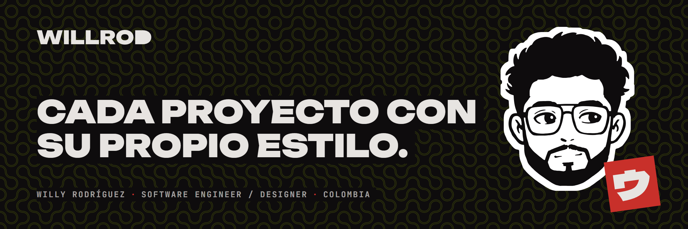
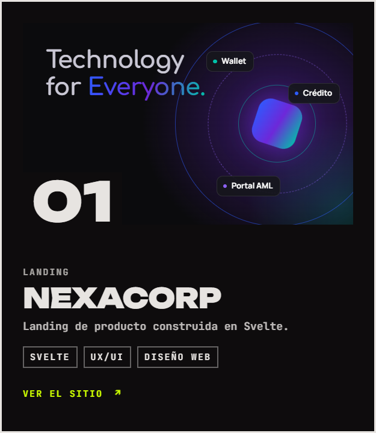
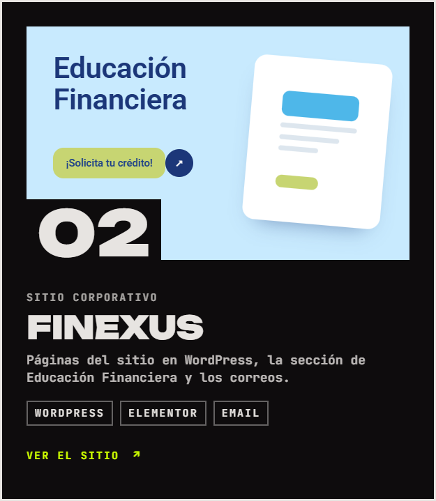
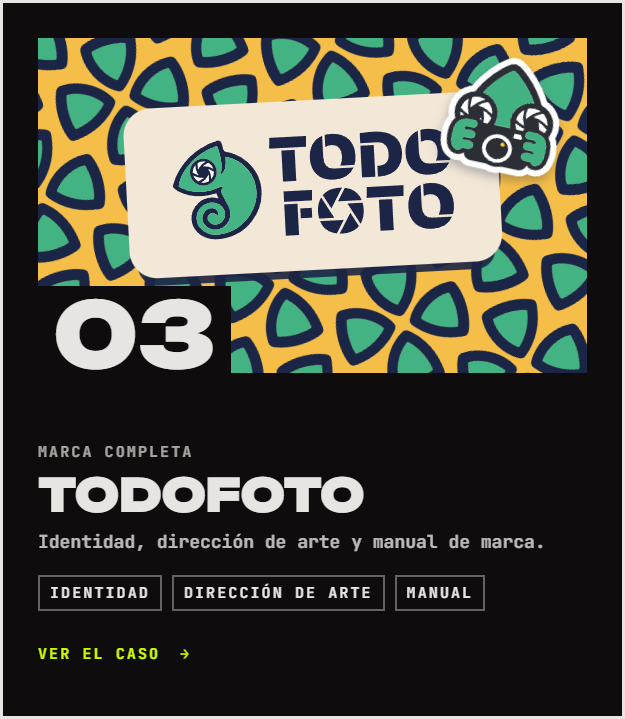
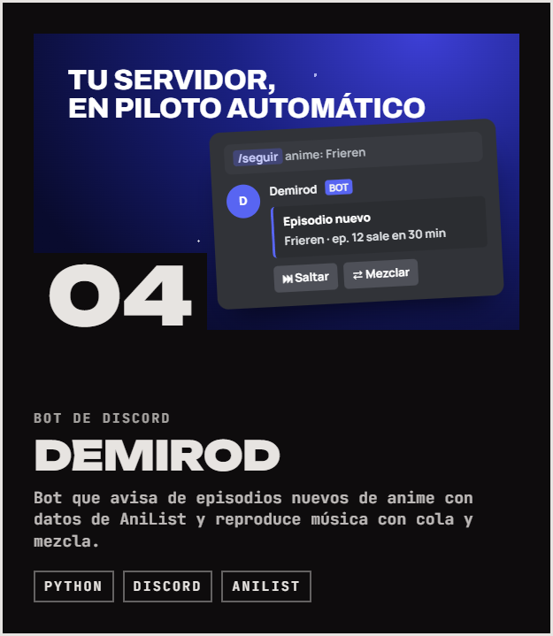
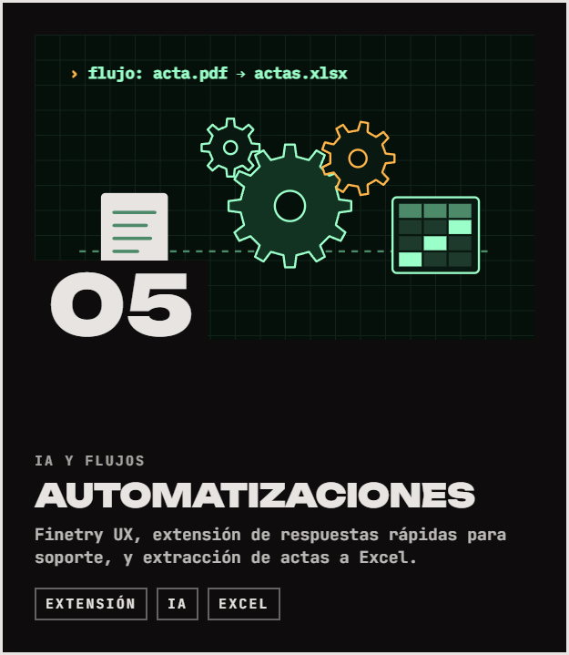
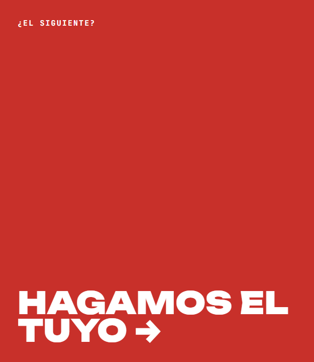

  
  
  

Soy Willy Rodríguez, ingeniero de sistemas en Colombia. Diseño y desarrollo proyectos digitales, desde la identidad visual hasta la última línea de código.

## Qué hago

| Área | En qué consiste | Herramientas |
|---|---|---|
| `01` **Marca e identidad** | Logo, mascota, patrones y manual de marca para que la identidad se aplique igual en todos los medios. | Illustrator · Photoshop · Figma |
| `02` **Web y producto** | Sitios en Astro, Svelte o WordPress, rápidos y fáciles de administrar. | Astro · Svelte · WordPress |
| `03` **Automatización e IA** | Bots y flujos que automatizan las tareas repetitivas de tu operación. | Python · TypeScript · MCP |
| `04` **UX / UI** | Interfaces claras, que se entienden a la primera y no saturan la pantalla. | Figma · sistemas de diseño |
| `05` **Infraestructura** | Redes, correo y servidores configurados para que lo que entrego siga funcionando. | Redes · cloud · soporte |

## Proyectos

Proyectos entregados a clientes reales, con su alcance y la tecnología que usé.

<table>
  <tr>
    <td width="33%"></td>
    <td width="33%"></td>
    <td width="33%"></td>
  </tr>
  <tr>
    <td width="33%"></td>
    <td width="33%"></td>
    <td width="33%"></td>
  </tr>
</table>

## Cómo trabajo

Trabajo con un proceso ágil e iterativo: analizo los requerimientos, defino el alcance y desarrollo por entregas cortas que validas antes de avanzar. Aplica igual a proyectos de marca, desarrollo web o automatización, y cada fase deja un entregable concreto.

## Herramientas

<b>Código</b> 
      

<b>Web</b> 
   

<b>Diseño y motion</b> 
    

<b>IA y gestión</b> 
  

## Contacto

¿Tienes un proyecto en mente? Escríbeme a **[will.rod0102@gmail.com](mailto:will.rod0102@gmail.com)** o mira el trabajo completo en **[willrod.dev](https://willrod.dev)**.
