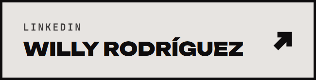
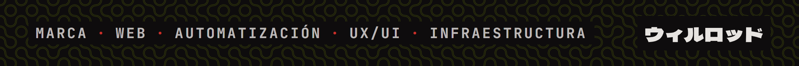

 

Diseño y desarrollo proyectos digitales, desde la identidad visual hasta la última línea de código.

  &nbsp;&nbsp;
  

 

<b>Código</b> 
      

<b>Web</b> 
   

<b>Diseño y motion</b> 
    

<b>IA y gestión</b> 
  

 

